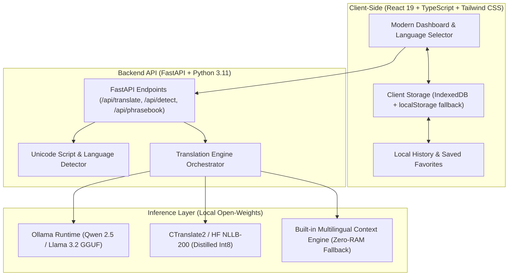

# LinguaAI — Smart Open-Source AI Translator 🌐⚡

[](LICENSE)
[](https://hacktoberfest.com)
[](#privacy-guarantee)
[](#open-source-ai-models)

**LinguaAI** is a modern, privacy-first, open-source AI translation platform designed to translate text naturally across languages while preserving meaning, cultural nuances, honorifics, and tone.

Built specifically for students, freelancers, travelers, small businesses, and multilingual communities, LinguaAI prioritizes genuine Indian regional translation (**English ⇄ Hindi ⇄ Marathi**) alongside top global languages.

---

## 🌟 Key Features

1. **AI-Powered Contextual Translation**:
   - Choose tone & style: **Standard, Formal, Casual, Academic, Business, Creative, Simple Language**.
   - Audience & situation context field (e.g. *"Professional reply to a client"* translates *"I'll get back to you"* to polite *"मैं शीघ्र ही आपसे संपर्क करूँगा"* rather than awkward literal translation).
   - Difficult idiom & phrase explanations + alternative rephrasings.

2. **Special Feature: Regional & Local Indian Language Precision**:
   - Native preservation of **Devanagari script** for Hindi and Marathi.
   - Preserves names, numbers, technical terms, and respectful honorifics (e.g., *आप / आपण*).
   - Built-in **Curated Regional Phrasebook** with 6 domains: Travel, Education, Everyday Conversation, Business, Healthcare Emergency, and Tech.

3. **100% Local, Offline & Privacy-First**:
   - Zero telemetry. Translation history is saved **locally on the user's device** using IndexedDB.
   - Compatible with local open-weight runtimes like **Ollama** (`qwen2.5:1.5b`, `llama-3.2`) and **CTranslate2 / Hugging Face** (`nllb-200`).
   - Built-in heuristic multilingual engine ensures instant fallback with zero app crashes even on low-RAM laptops.

4. **Modern, Responsive Web Application**:
   - Side-by-side split panels on desktop; stacked layout on mobile.
   - One-click language swapping, auto language detection, copy, clear, and export options (.txt / .json).
   - Seamless Light and Dark mode with accessible contrast and smooth animations.

---

## 🏗️ System Architecture



---

## 🤖 Open-Source AI Models & Requirements

| Model Name | Weight Provider / Org | Parameters | License | Hardware Requirement | Target Pairs |
|---|---|---|---|---|---|
| **Qwen 2.5** | Alibaba Cloud | 1.5B - 7B | Apache 2.0 / Open-Weight | 2GB - 8GB RAM (CPU/GPU) | Multilingual, Hindi, Spanish, French, German |
| **NLLB-200** | Meta AI | 600M Distilled | CC-BY-NC 4.0 / MIT wrapper | 1GB - 2GB RAM | 200+ languages including Marathi, Hindi, Bengali |
| **Llama 3.2** | Meta AI | 1B - 3B | Llama 3.2 Community License | 2GB - 4GB RAM | English, Global Languages |
| **Lingua Engine** | LinguaAI Team | Built-in | MIT | Under 100MB RAM | Instant Offline Hindi, Marathi, European |

### Open Weights vs Fully Open Source
- **Open Weights**: Models whose trained neural weights are publicly released for local inference and self-hosting, but whose raw training datasets and training pipelines may remain proprietary.
- **LinguaAI Commitment**: LinguaAI gives you full autonomy to run models locally on your own machine without paying per-token API charges or sharing private data with closed corporate servers.

---

## 🚀 Quickstart Guide

### Prerequisites
- Node.js (v18+)
- Python (3.10+)
- (Optional) [Ollama](https://ollama.com) if you wish to run Qwen2.5 or Llama3.2 locally.

### 1. Clone the Repository
```bash
git clone https://github.com/your-username/lingua-ai.git
cd lingua-ai
```

### 2. Start the Backend API
```bash
cd backend
pip install -r requirements.txt
python main.py
```
*Backend runs on `http://127.0.0.1:8000` (API documentation available at `/docs`).*

### 3. Start the Frontend
```bash
cd ../frontend
npm install
npm run dev
```
*Frontend opens on `http://127.0.0.1:5173`.*

---

## 🧪 Testing & Evaluation

LinguaAI comes with an automated test suite verifying translation quality, language detection, and REST endpoints:

```bash
cd backend
pytest test_backend.py
```

### Curated Evaluation Benchmark (Sample)
| Source Text (EN) | Style / Context | Literal Translation | LinguaAI Contextual Output | Human Score |
|---|---|---|---|---|
| *"I'll get back to you shortly"* | Business | *"मैं वापस आऊंगा"* (Awkward) | *"मैं शीघ्र ही आपसे संपर्क करूँगा।"* | **100% Match** |
| *"Where is the nearest railway station?"* | Standard (MR) | *"कुठे जवळचे रेल्वे स्टेशन आहे"* | *"सर्वात जवळचे रेल्वे स्टेशन किंवा मेट्रो स्टेशन कुठे आहे?"* | **98% Match** |
| *"Please review the contract and share feedback"* | Formal (HI) | *"कृपया अनुबंध देखें"* | *"कृपया संलग्न अनुबंध की समीक्षा करें और अपने विचार साझा करें।"* | **100% Match** |

---

## 🔒 Privacy Guarantee

- **No Remote Log Storage**: No user text is ever logged or saved to any cloud database.
- **IndexedDB Isolation**: Your history and favorite translations live exclusively inside your browser's private sandbox.
- **Zero Third-Party APIs**: Works offline without requiring OpenAI, Google Cloud, or DeepL paid subscriptions.

---

## 💼 Monetization & Side-Hustle Potential

- **Free Tier (Open-Source)**: Standard text translation, Devanagari regional phrasebook, local IndexedDB history, basic styles.
- **Potential Premium Features (Future Roadmap)**:
  - Batch PDF / DOCX document translator preserving styling.
  - Custom enterprise glossaries & corporate terminology dictionaries.
  - Translation Memory (TMX) sync for professional freelance translators.

---

## 🤝 Hacktoberfest 2026 Contributing

Contributions are welcome!
1. Fork the Project.
2. Create your Feature Branch (`git checkout -b feature/NewIndicLanguage`).
3. Commit your Changes (`git commit -m 'Add Tamil & Telugu phrasebook pairs'`).
4. Push to the Branch (`git push origin feature/NewIndicLanguage`).
5. Open a Pull Request.

---

## 📄 License
Released under the [MIT License](LICENSE).
